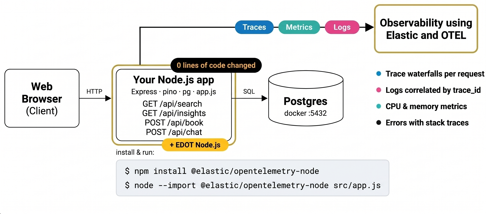

# Skyward for Business — Node.js observability demo with Elastic

[](https://codespaces.new/suyashcjoshi/elastic-observability-nodejs-demo?quickstart=1)
[](https://www.elastic.co/docs/reference/opentelemetry/edot-sdks/node)
[](https://nodejs.org)
[](LICENSE)

A Node.js flight search app instrumented with Elastic Observability (EDOT). This is the **`fixed`** branch: the app runs with no intentional bugs. Check out `main` for the deliberately broken version used to demo finding and fixing problems in Elastic.

The app has no OpenTelemetry code. Elastic gets its data from one startup flag:

```sh
node --env-file=.env --import @elastic/opentelemetry-node src/app.js
```

That command (what `npm start` runs) starts only the app. To start everything (Postgres, partners and the app), run `npm run dev`.

> **Using an AI coding tool?** Point it at [AGENTS.md](AGENTS.md).

## Architecture



## Quick start

**You need:** Node.js 20.6+ and Docker. An Elastic Cloud project is only needed for step 2.

### 1. Run the app

```bash
git clone https://github.com/suyashcjoshi/elastic-observability-nodejs-demo
cd elastic-observability-nodejs-demo
npm install
cp .env.example .env
npm run dev          # starts Postgres, seeds it, starts partners and app
npm run verify       # prints PASS when everything works
```

Open http://localhost:3000 and click Search (LHR → SFO is pre-filled).

In a Codespace, click the badge at the top instead. The app is ready on port 3000 in about two minutes.

### 2. Connect to Elastic

Adding Elastic takes two commands and no code changes:

```bash
npm install @elastic/opentelemetry-node                  # already in package.json in this repo
node --env-file=.eok nv --import @elastic/opentelemetry-node src/app.js     # what `npm start` runs
```

Then point it at your Elastic project:

1. No Elastic account? Start a free trial at [cloud.elastic.co/registration](https://cloud.elastic.co/registration) and choose **Serverless → Observability**.
2. In your project, open **Add data → Application → OpenTelemetry** and copy the endpoint and API key.
3. Add them to `.env`:
   ```
   OTEL_EXPORTER_OTLP_ENDPOINT=https://<your-project>.ingest.<region>.elastic.cloud:443
   OTEL_EXPORTER_OTLP_HEADERS=Authorization=ApiKey <your-api-key>
   ```
4. Run `npm run dev`. After a minute, the app shows up under **Observability → Services**. The service name comes from `service.name` in `OTEL_RESOURCE_ATTRIBUTES` (or `OTEL_SERVICE_NAME`) in `.env`, for example `skyward-travel-app` if you copied the snippet from Elastic. If it isn't set, EDOT picks a default name.

## Useful commands

| Command | What it does |
|---|---|
| `npm run dev` | Start everything (Postgres, partners, app) |
| `npm run verify` | Check all endpoints |
| `npm run stop:all` | Stop everything |
| `npm test` | Run smoke tests |

To run with Docker instead: `docker compose up -d` (and `docker compose down` to stop).

## Learn more

- [EDOT Node.js setup](https://www.elastic.co/docs/reference/opentelemetry/edot-sdks/node/setup)
- [Quickstart: monitor application performance](https://www.elastic.co/docs/solutions/observability/get-started/quickstart-monitor-your-application-performance)
- No cloud account? Run Elastic locally: `curl -fsSL https://elastic.co/start-local | sh -s -- --edot`

## License

Apache-2.0. See [LICENSE](LICENSE).
